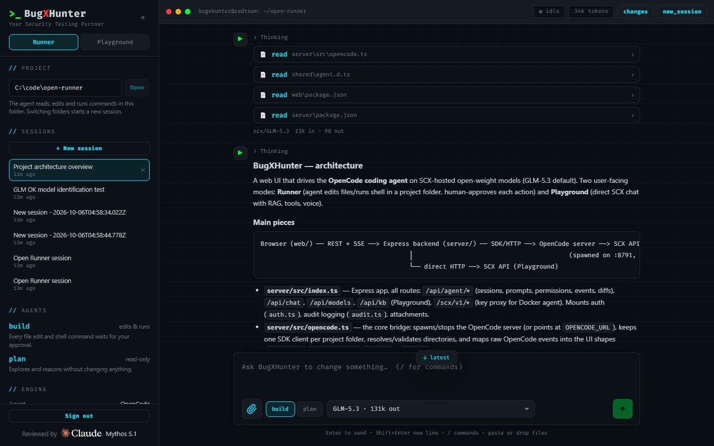
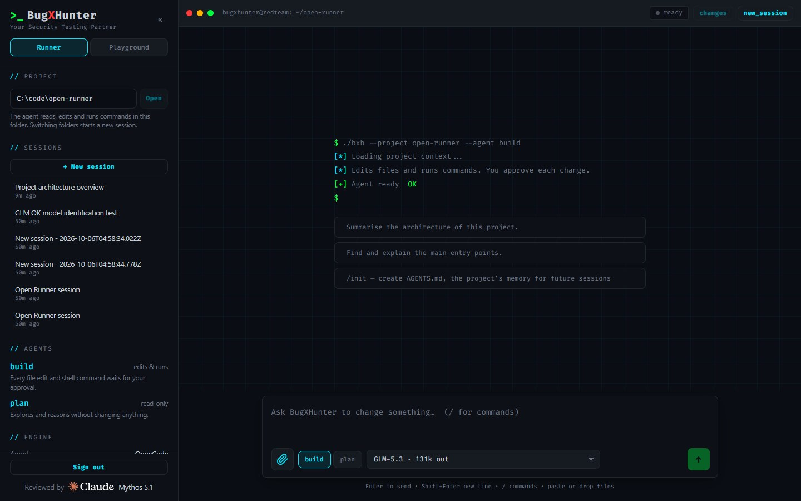
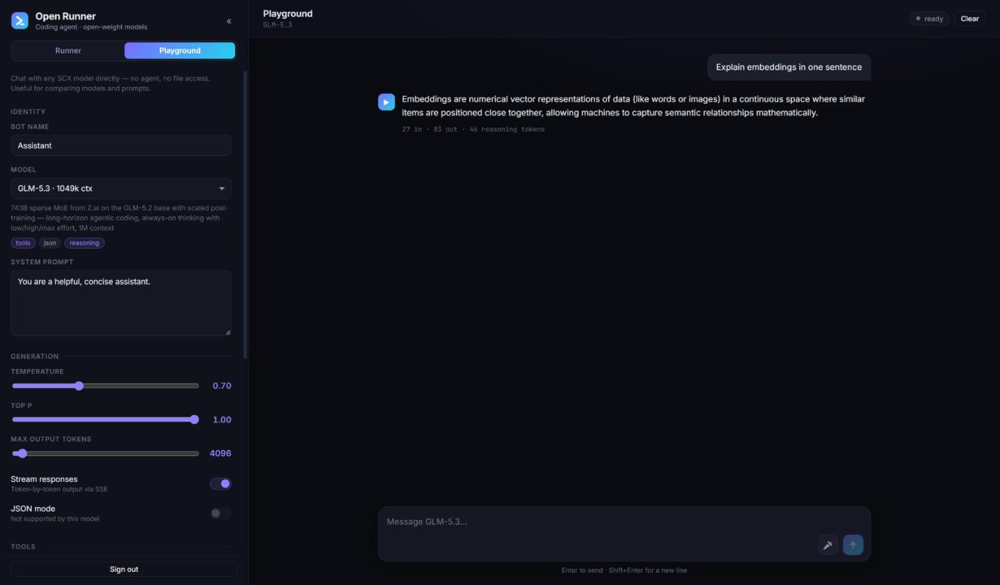

# BugXHunter

[](https://github.com/cintelis/bugxhunter-runner/actions/workflows/ci.yml)
[](https://github.com/cintelis/bugxhunter-runner/actions/workflows/codeql.yml)
[](https://claude.com/claude-code)
[](https://www.anthropic.com/claude/mythos)

The [BugXHunter](https://bugxhunter.com) security-testing agent runner: a web UI for the
[OpenCode](https://opencode.ai) coding agent, running on open-weight models (GLM-5.3 by default)
through [SCX.ai](https://platform.scx.ai). The UI follows bugxhunter.com's design system — a
macOS-style terminal window, the red-team palette (GitHub-dark surfaces with red, amber, cyan and
green accents) and Fira Code throughout. Started from the `sovgov-poc` chatbot designer.

- **Runner** — point it at a project folder and drive OpenCode's `build` (edits + shell) or
  `plan` (read-only) agent. Every file edit and shell command waits for your approval.
  Markdown replies, collapsible tool calls and reasoning, per-turn token counts, and a
  **Changes** view of what the agent edited (git repos only — OpenCode tracks changes via git).
- **Playground** — chat with any SCX, Anthropic (Claude), NVIDIA, OpenRouter or Amazon Bedrock model directly (no agent), with
  tool-calling, JSON mode, an embeddings-backed knowledge base and browser voice. Also:
  - **Security presets** (code review, threat modelling, AI system review, pentest planning,
    diagram review, diagram drawing, tabletop exercises, CTF coaching, phishing, log triage,
    vulnerability explaining) and **compare mode** (2–3 models side by side, with speed and tokens).
    Every preset, the canvas and the agent work from one catalogue (`web/src/intel`): OWASP Top
    10:2025, API Security Top 10:2023, Top 10 for LLM Applications 2025, Top 10 for Agentic
    Applications 2026, Mobile Top 10 2024, ASVS 5.0, WSTG 4.2, STRIDE, and MITRE ATLAS tactics,
    techniques and mitigations for attacks on AI systems, so findings cite the same ids everywhere.
  - **Flag highlighting** for CTFs and labs: anything matching the flag format (a regular expression
    in the sidebar, default `flag{...}` and the like) is marked in replies and tool output, in both modes.
  - **Images** for vision models, and **draw.io files** (`.drawio`, compressed or not, and
    `.drawio.svg`) for any model: the file becomes an exact text outline of its zones, boxes,
    legend colours and arrows, so labels are never misread.
  - **Text files** (`.md`, `.markdown`, `.txt`) for any model, in chat, compare mode and the
    canvas: a design note, a written description of a system or a log excerpt is read in the
    browser and sent in full. Up to 5 files of 512 KB each per message.
  - **Diagrams in replies**: a model writes a ```` ```drawio ```` spec and the app draws it as an
    editable `.drawio.svg` ([drawgen](https://github.com/cintelis/drawio-tools)), checks it, and
    can send the problems back for a fix.
  - **Threat-model canvas**: build a model from a diagram or description, track findings,
    scope and coverage, zoom and pan, export JSON, `findings.md`, SVG or draw.io.
  - **Saved sessions**: chats and canvases are sealed with the vault key on the runner
    (Docker: the `runner-data` volume), never in browser storage.
  - Retired NVIDIA models (their endpoints answer 404) are found and hidden automatically.

## Screenshots

The agent working in a project — live tool calls, reasoning, and a markdown summary:



Point it at any folder; resume past sessions; approve edits and commands as they happen. The key
vault's state and lock live in the sidebar footer:



Playground — compare SCX models directly with full generation controls:



## Install

The quickest way, with Node 22+ installed, is the npm package (OpenCode comes with it):

```bash
npx bugxhunter            # runs the agent on this machine; UI opens at http://localhost:8790
npx bugxhunter docker     # the sandboxed stack instead (needs Docker Desktop): pulls the signed
                          # images for this version into ~/.config/bugxhunter/docker and starts them
```

`npm i -g bugxhunter` makes it a plain `bugxhunter` command; `bugxhunter --help` lists the
options (`--port`, `--dir`, `--no-open`; `docker --slim|--full`, `docker down|logs|ps`,
`docker export <path> [dest]`; `vault reset`). The current
folder becomes the default project. Then, in the sidebar: set up the [vault](#key-vault) with a
passkey, add your SCX.ai key as `SCX_API`, and [connect GitHub](#github-repositories-read-only).
The package is published by the release workflow with npm provenance: `npm audit signatures`
confirms it was built from this repository.

## Requirements (from source)

- Node 22+
- OpenCode on `PATH`: `npm install` here provides it, or `npm i -g opencode-ai`
- An SCX.ai key: in the [vault](#key-vault) (preferred), else `opencode auth login` (choose
  **Other**, provider id `scx`) or `SCX_API` in a `.env` here.

## Run from source

```bash
npm install
npm run dev          # backend :8790 + web :5190, with hot reload
npm start            # or: the compiled app, the same way `npx bugxhunter` runs it (npm run build first)
```

Open **http://localhost:5190** (dev) or **http://localhost:8790** (`npm start`).

The backend starts its own OpenCode server on `127.0.0.1:8791` (it stops a stale one left on
that port by a previous run). Everything listens on localhost only. There are no passwords:
until you set up the [vault](#key-vault) the app is open, and from then on you sign in with the
vault's passkey.

## Docker (sandboxed agent + login)

`npx bugxhunter docker` does all of this (any OS). By hand, from a checkout:

```powershell
powershell -File docker/setup.ps1     # once: writes .env — the secrets the two containers share
docker compose up -d --build          # build locally, or `docker compose pull && docker compose up -d`
                                      # for the published images (set BXH_VERSION in .env to pin a signed release)
```

The images are multi-arch (linux/amd64 and linux/arm64, so Apple Silicon and Graviton run them
natively) with zstd-compressed layers (Docker 23+). The agent image comes in two flavours: the
default carries the scan toolchain (nuclei, nmap, httpx, katana, ffuf, gitleaks, testssl and
wordlists) plus the Rust and Go toolchains, about 750 MB to download; **`-slim`** leaves all of that out for code review only, about a third of
the size (`npx bugxhunter docker --slim`, or `BXH_AGENT_FLAVOR=-slim` in `.env`). Open
**http://localhost:8790** and set up the [vault](#key-vault) in the sidebar: it seals your SCX
key and turns on passkey sign-in. (`setup.ps1 -CopyScxKey` copies
the key into `.env` instead, in the clear.)

Three containers (plus the egress logger):

| Container | Holds | Network |
|---|---|---|
| `runner` | Web UI, login, SCX key, `/scx/v1` key proxy | shared bridge, published on 127.0.0.1 |
| `agent` | OpenCode, the agent's shell + scan tools, `/workspace` volume | shared bridge — **direct internet** |
| `render` | drawgen: model-written diagram specs → `.drawio.svg`, and `.drawio` files → outlines | internal network shared only with `runner` — **no internet** |

- Model output and uploaded diagram files are parsed in `render`, not in the `runner` that holds
  the keys: no volumes, no secrets, read-only, non-root, 512 MB and 1 CPU, each job in its own
  process with a 10 s limit. drawgen is installed from a release wheel pinned by SHA-256.

- The agent's model calls go to `runner`'s proxy with a proxy token; the proxy swaps in the real
  key and only allows `/chat/completions` and `/models`. **The SCX key never enters the agent
  container** — this holds even though the agent has direct internet.
- Projects live in the `workspace` Docker volume (`/workspace`, a git repo so Changes work). No
  host folders are mounted.
- **Workspaces and files in the UI**: the sidebar's **workspaces** button lists the folders under
  `/workspace` (locally `~/bugxhunter/repos`, or `OPEN_RUNNER_WORKSPACE`), including GitHub
  clones, and creates a new one (an empty git repository) or deletes one. A delete asks for the
  name typed back, the open project can't be deleted, and only a listed workspace can be. The
  **files** button browses the open project: click a file to download it, and upload with the
  button or by dropping files on the list (up to 200 MB each). An upload never replaces a file;
  a clash is saved as `name-1.ext`.
- From the command line, copy a repo in as a snapshot, and results back out:

  ```powershell
  powershell -File docker/copy-in.ps1 C:\code\my-repo          # -> /workspace/my-repo (skips node_modules, .env, …)
  powershell -File docker/copy-out.ps1 my-repo C:\temp\my-repo-out
  ```

  (Plain `docker compose cp` also copies in, but leaves files owned by root, so neither the agent nor uploads can
  write there. To fix a folder copied that way: `docker run --rm -u root -v bugxhunter_workspace:/workspace
  --entrypoint chown ghcr.io/cintelis/bugxhunter-agent -R node:node /workspace/<folder>`.)
- **Getting files out**: `/workspace` is a Docker volume, so there is no host folder to open. Any
  file path the agent prints under the project (for example "Saved as
  `/workspace/acme/app/analysis.md`") is a download link in the UI, served only for files inside
  the project folder. From a terminal, `npx bugxhunter@latest docker export acme/app/analysis.md`
  (or an absolute `/workspace/...` path; optional destination as the second argument) copies a file
  or folder out.
- **The agent has direct internet** so scan tools run at full speed (`nmap`/`ping`/raw DNS work
  via `NET_RAW`). Outbound connections are logged, not restricted — **only point the agent at targets you are authorised to test, and run this on a
  trusted machine/VM.**
- Both containers run as non-root with `no-new-privileges`; the agent drops all capabilities except
  `NET_RAW` and is limited to 2 CPUs, 4 GB RAM, 512 processes. Shell commands and file edits are
  approved in the UI — that, plus the container/VM boundary and the isolated SCX key, is what
  contains the agent.
- **Logs** (the audit log of prompts, tool calls and approvals, plus the egress log of hosts the
  agent connected to) live in the `logs` volume, which the agent container can't see. Read them with
  `docker compose cp runner:/logs ./logs`.
- Port 8790 is published on localhost only. Put TLS (a reverse proxy) in front and set
  `COOKIE_SECURE=1`, `TRUST_PROXY=1` and `ALLOWED_HOSTS=<your domain>` before exposing it to anyone else.

## Key vault

The SCX key (and any other secret the agent needs) lives in a vault that is **sealed at rest**: on
disk there is only ciphertext and wrapped keys, so a copied `.env`, volume or container yields
nothing. Set it up from the sidebar after the first start; it takes a minute:

1. **Passkey** — Windows Hello, Touch ID, Android, or a security key. One touch unlocks the vault
   and signs you in; the authenticator's own biometric or PIN is the second factor. It derives a
   secret (WebAuthn PRF) that never leaves the device. Chrome, Edge and Safari 18+; Firefox can't
   do this yet. Open the app as `http://localhost:…`, not by IP.
2. **Recovery code** — shown once, stored nowhere. Keep it offline. It opens the vault if the
   passkey is lost.
3. **Backup passphrase** (optional) — a way in on a device without the passkey.

The decryption key lives only in the backend's memory, so after every restart, and after
**2 hours without activity** (`OPEN_RUNNER_VAULT_IDLE_MINUTES`), someone has to unlock it before the
agent can call a model. **Ctrl+Shift+L** locks it at once. The crypto is symmetric only
(AES-256-GCM, HKDF-SHA-256, PBKDF2-SHA-256), which keeps it out of reach of a quantum attacker;
see [SECURITY.md](SECURITY.md#the-key-vault).

While the vault is locked, model calls fail with a clear "vault is sealed" message. Without a vault
the app takes the key from a key file (`SCX_API_FILE`), else falls back to `SCX_API` in `.env` or
OpenCode's `auth.json`, in the clear. A key file is for a runner nobody unlocks, such as one behind
Sigilant: mount it as a secret; it is re-read on every call, so replacing it rotates the key, and if
it cannot be read the call fails rather than falling back to a key in the clear.

**Sign-in is the same passkey.** Once a vault exists the API needs a session, and the ways in are
a WebAuthn assertion with one of the vault's passkeys (verified server-side), the backup
passphrase, or the recovery code. One touch at the sign-in screen signs in and unlocks the vault.
Keep two passkeys on different devices (keys dialog → add passkey). Lost every factor? Someone with
access to the server's files runs `npm run vault:reset` (Docker: `docker compose exec runner rm
/data/vault.json`): the vault and its secrets are gone and the app reopens for a fresh setup.
Nothing on the network can do that, which is what keeps the lock meaningful.

## Other models via OpenRouter

SCX.ai is the default provider. To use anything from [OpenRouter's catalogue](https://openrouter.ai/models)
as well:

1. Add your OpenRouter key to the vault as `OPENROUTER_API_KEY` (keys dialog in the sidebar). The
   **Playground** then lists OpenRouter's models under their own heading, addressed as
   `openrouter/<id>`.
2. For the **agent**, list the ids it may use in `OPENROUTER_MODELS` (comma-separated, e.g.
   `anthropic/claude-sonnet-4.5,openai/gpt-6.1-sol`), in `.env`. Only those appear in the Runner's model
   picker, as `openrouter/…`. In Docker, both containers read the same variable.

The agent never holds the key: its calls go to the runner's `/openrouter/v1` proxy with the proxy
token, exactly like SCX, in both local and Docker modes. Pricing is OpenRouter's; the Playground
shows each model's per-token rates.

## GLM 5.3 on Amazon Bedrock

The runner can call models on [Amazon Bedrock](https://aws.amazon.com/bedrock/) directly, in your
own AWS account: GLM 5.3 by default, through Bedrock's OpenAI-compatible endpoint
(`bedrock-runtime.<region>.amazonaws.com/openai/v1`). The **Playground** lists them under an
**Amazon Bedrock** heading as `bedrock/<id>`; the **agent** gets them as `bedrock/<id>` too.

Set the region with `BEDROCK_REGION` (else `AWS_REGION`), then sign in one of these ways. The first
that is set up is used, and a Bedrock API key wins over all of them:

| Sign-in | Set | Use it when |
|---|---|---|
| **OIDC role** (web identity) | `AWS_ROLE_ARN` and `AWS_WEB_IDENTITY_TOKEN_FILE` | The runner runs where an identity provider issues it a token: GitHub Actions, Kubernetes (EKS IRSA), another OIDC issuer the role trusts. Nothing long-lived exists: the runner trades the token for role credentials through STS and renews them itself |
| **AWS profile** | `BEDROCK_AWS_PROFILE` (else `AWS_PROFILE`) | The runner is on your own machine. An IAM Identity Center (SSO) profile gives short-lived credentials that `aws sso login` renews; a profile with `role_arn` narrows them to a role that may only invoke the model |
| **The compute's role** | nothing on ECS; `BEDROCK_AUTH=aws` on EC2 or with a default profile | The runner is deployed in AWS: a task role, pod identity or instance profile |
| **Access keys** | `AWS_ACCESS_KEY_ID`, `AWS_SECRET_ACCESS_KEY` (and `AWS_SESSION_TOKEN`) | Temporary keys pasted for a session. Avoid an IAM user's long-lived keys |
| **Bedrock API key** | vault item `AWS_BEARER_TOKEN_BEDROCK` (keys dialog), or `AWS_BEARER_TOKEN_BEDROCK_FILE` | You cannot give the runner an AWS identity. Sealed in the vault like the other keys. Short-term keys last 12 hours at most; a long-term key is an IAM user's standing credential, which AWS recommends for exploration only |

**Which to choose:** a role the runner is given beats anything it has to hold. Deployed in AWS, use
the compute's role; in CI or Kubernetes, the OIDC role; on your own machine, an SSO profile. Keep
the API key and access keys for when none of those is possible.

In Docker the profile needs your AWS config: uncomment the `~/.aws` volume on the `runner` service
in `docker-compose.yml` (read-only, and only the runner gets it), set `BEDROCK_AWS_PROFILE` and
`BEDROCK_REGION` in `.env`, and set `BEDROCK_MODELS=global.zai.glm-5.3` so the agent's picker shows
the model. When the SSO session lapses, model calls answer with a 503 that says so: run
`aws sso login` on the host and carry on, no restart needed. On Linux the files under `~/.aws` must
be readable by the container's user (uid 1000).

As with every provider, the agent holds nothing: its calls go to the runner's `/bedrock/v1` proxy
with the proxy token, and the runner signs them (SigV4) or adds the key. AWS credentials are
removed from the runner's environment at start-up, so the agent's shell does not inherit them in
local mode either.

Things to know:

- **Locking the vault stops Bedrock too.** AWS credentials are not vault items, so once a vault
  exists the runner refuses to sign while it is sealed (model calls answer 503) and drops the
  credentials it holds in memory. The first call after an unlock loads them afresh from the
  profile or role. This is a gate in the runner, not encryption: a mounted `~/.aws` stays readable
  to the runner's container, so give it a profile that can do no more than invoke the model.
- **Reasoning effort.** GLM 5.3 on Bedrock reasons at `max` effort unless told otherwise, and
  reasoning counts against the output limit: at a 4,096-token limit a request can spend all of it
  thinking and write nothing (the chat says so when that happens). The Playground's **Reasoning
  effort** setting picks `low`, `medium`, `high`, `xhigh` or `max` per chat.
  `BEDROCK_REASONING_EFFORT` sets the runner's default for every Bedrock call that names none,
  the agent's included.
- **OpenAI's GPT models.** `global.openai.gpt-6.2-astra` and `global.openai.gpt-6-astra` are known
  to the runner: add one to `BEDROCK_MODELS` to use it. They read images, so the threat-model
  canvas can build from a screenshot. They take the output limit as `max_completion_tokens` and
  refuse `stop` and any temperature or top-p but the default, so the runner renames the one and
  drops the others. **They are for the Playground only**: Bedrock's Chat Completions route
  refuses function tools for them (its Responses route takes them, which the runner does not
  speak), so they are left out of the agent's model picker and the Playground sends them no tools.
  They are not open-weight, and cost far more per token than GLM 5.3.
- **Only the models you list.** The agent can call a Bedrock model only if it is in
  `BEDROCK_MODELS`; the proxy answers 403 for any other. The runner's AWS identity can usually
  invoke more than that, and the agent runs untrusted input.
- **GLM 5.3 has no single-region form.** It is called through a cross-region inference profile:
  `global.zai.glm-5.3` from most regions (inference may then run in any commercial AWS region), or
  `us.zai.glm-5.3` from US regions only. Prompts, code and tool output go where the profile sends
  them, so check that against where your engagement's data may be processed.
- **Access is per account.** AWS offers GLM 5.3 to eligible accounts only; one without it answers
  `403 … is not available for this account` even though the model is listed.
- **Other ids.** `BEDROCK_MODELS` takes any model or inference-profile id the endpoint serves,
  including the ARN of your own application inference profile (which puts the spend under that
  profile's cost-allocation tags). Ids the runner has no metadata for get conservative limits.
- **Permissions.** The role needs `bedrock:InvokeModel` and `bedrock:InvokeModelWithResponseStream`
  on the inference profile and on the model behind it, and nothing else. A starting point:

  ```json
  {
    "Version": "2012-10-17",
    "Statement": [{
      "Effect": "Allow",
      "Action": ["bedrock:InvokeModel", "bedrock:InvokeModelWithResponseStream"],
      "Resource": [
        "arn:aws:bedrock:ap-southeast-2:111122223333:inference-profile/global.zai.glm-5.3",
        "arn:aws:bedrock:*::foundation-model/zai.glm-5.3"
      ]
    }]
  }
  ```

  An API key also needs `bedrock:CallWithBearerToken`, which some organisations deny by policy.

## Claude via the Anthropic API

1. Add your Anthropic key to the vault as `ANTHROPIC_API_KEY` (keys dialog). The **Playground**
   then lists every Claude model the key can use under an **Anthropic** heading, addressed as
   `anthropic/<id>` (for example `anthropic/claude-opus-5-5`).
2. The **agent** gets Claude Opus 5.5, Sonnet 5.5 and Haiku 5.5 in the Runner's model picker.
   Locally, `ANTHROPIC_MODELS` (comma-separated model ids) changes that list; in Docker the list
   is in `docker/opencode.json`.

As with the other providers, the agent never holds the key: OpenCode's own Anthropic client calls
the runner's `/anthropic/v1` proxy with the proxy token, and the runner adds the key.

Things that differ from the OpenAI-style providers:

- **Sampling settings are not sent.** Current Claude models reject temperature and top-p, so the
  Playground's sliders don't apply to them. Forced tool use is sent as "auto" for the same reason.
- **Safety classifiers.** Claude's classifiers can decline some security requests. On models that
  support it, the Playground asks for Anthropic's server-side fallback, so a declined request is
  retried on the model Anthropic recommends for that category. A decline that still stands shows
  as an error naming the category. For authorised security work, Anthropic's
  [Cyber Verification Program](https://support.claude.com/en/articles/14604842-real-time-cyber-safeguards-on-claude-opus-and-sonnet)
  can lift cyber-category declines.
- **Prompt caching** is on, so repeated history in a long chat is billed at the cached rate, and
  chats that share a preset share its cached system prompt. Each reply's token line shows it:
  `9340 in (9000 cached, 300 written)`. Entries last an hour from their last use, so a pause to read a
  long reply does not lose them (`ANTHROPIC_CACHE_TTL=5m` for five minutes, which is cheaper to write:
  1.25 times the input price against 2). Knowledge-base
  passages are sent with the question, not in the system prompt, so they do not reset the cache.
  Changing the system prompt, the tools or JSON mode mid-chat does.

## GitHub repositories (read-only)

To review a repository, clone it into the workspace from the sidebar (**clone from GitHub** under
the project folder). The first time, click **Connect GitHub**: a short code appears, you enter it
at github.com/login/device, and the runner is signed in. Then **Choose repositories on GitHub**
opens the app's install screen, where you pick which repositories it may read; the list in the
dialog refreshes when you come back. Nothing to register, no token to paste.

The sign-in is to the public **BugXHunter** GitHub App, which declares only *Contents: read-only*
and *Metadata: read-only*, so even GitHub will refuse a push with its token. It reaches only the
repositories you install it on, and you can change that list or revoke the app on GitHub at any
time. Its tokens expire after eight hours and are refreshed by the runner; the pair is sealed in
the vault (or, before a vault exists, kept in memory until the runner restarts).

A clone lands in `<workspace>/<owner>/<repo>` (Docker: the shared `workspace` volume; locally
`~/bugxhunter/repos`, or `OPEN_RUNNER_WORKSPACE`) and becomes the project folder. Cloning again
fast-forwards it and never resets local edits.

**The runner does the cloning, the agent gets a working copy.** The token is passed to git as a
process-scoped header, so it is in neither the command line nor the clone's `.git/config`. The
agent can read, grep and scan the code (gitleaks over the history included) and edit it locally,
but nothing in the sandbox can fetch, push, open issues or see any other repository. Pushing
results back is deliberately not built: findings leave through the UI, not through your GitHub
account.

A fork that wants its own app registers one (device flow on, *Contents: read-only*, installable
on any account) and sets `GITHUB_CLIENT_ID` and `GITHUB_APP_SLUG`.

## Security-testing tools (authorised use only)

The agent image ships a standard pentest toolchain for **authorised** testing (your own sites,
labs, CTFs). Build with `--build-arg SECTOOLS=0` to leave them out.

- **Vuln / web:** `nuclei` (templates baked in offline), `httpx`, `katana` (SPA/JS crawler),
  `ffuf` (+ SecLists wordlists in `/opt/wordlists`), `testssl`, `curl`, `openssl`, `subfinder`
  (passive).
- **Secrets (local, no network):** `gitleaks` — scan copied-in repos and JS bundles for leaked keys.
- **CTF and forensics (full image):** `file`, `binutils`, `binwalk`, `exiftool`, `exiv2`, `pngcheck`,
  `steghide`, `foremost`, `7z`, `tshark`, `john`, `sqlmap`, `gdb`, `strace` (`ltrace` on amd64), and Python's
  `pwntools`, `pycryptodome`, `z3` and `yara`, for labs and CTFs the user owns or is registered for.
  `--build-arg CTFTOOLS=0` leaves them out; `CTFTOOLS=1` adds them to a slim build. gef, RsaCtfTool,
  Volatility 3, radare2 and rockyou install on demand into `/workspace/.tools` (recipes in
  `docker/agent-AGENTS.md`), and the agent's instructions carry a first-look playbook per category.
- **Rust and Go:** `cargo` (with `clippy`, `rustfmt` and `cargo audit` for RustSec advisories) and
  `go` (with `govulncheck`), to build, test and audit Rust and Go repositories. `--build-arg RUST=0`
  or `GO=0` leaves one out; `RUST=1` / `GO=1` adds it to a slim build.
- **Raw-socket:** `nmap`, `ping`, `traceroute`, `dig`/`host` (incl. zone transfer).
- **Not included — LLM red-teaming:** `promptfoo` (~1.4 GB installed) and `garak` (~2 GB with
  CPU-only PyTorch, 5 GB+ if pip is left to pull the CUDA build) would more than double the image,
  so the agent installs them on demand into the persistent `/workspace/.tools` volume. The recipe,
  including pointing them at the runner's model proxy for grading, is in `docker/agent-AGENTS.md`.

All tools run directly against targets. The agent's `AGENTS.md` tells it to confirm authorisation
before scanning and to scan only hosts you name.

**Making scans fast** (they're slow if done naively):
- **Scope nuclei templates** — the biggest lever. `-tags cve,exposure` or `-severity
  critical,high,medium` instead of all ~14k templates. Fingerprint with httpx first and target the
  detected stack.
- **Pre-filter** with katana/httpx and feed only live URLs into nuclei/ffuf.
- **Tune to the target:** `-c 50 -rl 300 -bulk-size 50 -timeout 5` on a tolerant host; *lower* on a
  CDN/WAF target, where aggression trips rate-limits and is slower.
- **Run long scans detached**, writing to `/workspace` (`-o result.txt`), and poll the file so an
  aborted turn doesn't lose progress.

To fence the agent to a specific lab/target range, add firewall rules on the Docker host or the VM
you run this in — Docker's bridge NAT doesn't restrict outbound on its own.

## Supervised recon

The Runner's **recon** button starts a supervised test of one target. You give the target (one
host or URL), an objective, the environment (local, staging or production) and how it differs
from production, and confirm you are authorised to test it. The runner then drives the session
round after round:

1. **Route.** Each round the executor runs on the model its profile gives it. After two stuck
   rounds, or a High or Critical finding, the next round runs on the escalation model; a model
   that answers "rate limited" is routed around for a minute.
2. **Probe, under the gate.** Every shell command the executor (or a subagent) wants to run raises
   an approval. The gate answers the ones it can prove safe: a `curl` GET or HEAD to exactly the
   in-scope origin, an `nmap` version scan of the in-scope host, piped into read filters with
   allow-listed flags. A handful of shapes that would wreck or hijack the agent's own machine are
   rejected. Everything else waits for you, as an approval card. "Always allow" is off during a
   run, and the recon agents cannot use webfetch or websearch.
3. **Verify.** The executor hands each candidate to the `recon-verify` subagent, which rejects it
   without reproduction evidence and marks it *config-dependent* when it relies on a setting that
   differs from production. Only its verdicts become findings.
4. **Follow up.** From the second round on, once something is verified, each round starts from
   what the findings so far unlock (a credential, a token, an identifier, a level of access) and
   takes that next step, if there is one inside the scope, before it moves to a fresh hypothesis.
   A sequence that reaches something worse goes to `recon-verify` as an attack path and is
   recorded as soon as it is ruled on.
5. **Stop.** The run ends when the executor reports the surface exhausted, a round finds nothing
   new, the round or token cap is reached, it stays stuck after escalating, every model is
   rate-limited, a round fails, or you press stop.
6. **Chain.** When the loop ends with two or more findings, a chain pass tries to combine them
   into attack paths the loop did not already record. One turn on the escalation model proposes up to three paths, each naming the
   findings it builds on (`F1`, `F2`, …). The executor then has up to three rounds per path to
   show it end to end, under the same gate and scope, and hands it to `recon-verify`, which
   rejects a path unless every step has its evidence and each step used what the one before
   returned. A path that holds is recorded as *demonstrated*, rated on what the attacker ends up
   with and never below the worst finding it uses; it is config-dependent if any of those is. A
   path that stops (a write you declined, a step that did not work, the rounds running out) is
   recorded as *partial*, with the step and the reason: a lead, not a finding. The pass does not
   run after an error, rate limits or a stop. It spends what is left of the token budget and no
   more: once a run has two findings, the main loop leaves 15% of the budget for it.

A strip above the composer shows the round (or the chain pass's turn), tokens, model and how many
approvals the gate answered. The results appear in the transcript: attack paths first, then the
findings, each numbered and marked with the paths it is part of, then the unproven paths with the
step each stopped at. The start dialog has a checkbox to leave the chain pass out of a run. Gate decisions and the run's start and end go to
the audit log (`recon.gate`, `recon.started`, `recon.finished`). A run that is still going lives in the runner's
memory: restarting the runner ends it (the session and its transcript stay).

**Memory.** A finished run is kept, encrypted with the vault key, in `recon/` beside the vault
(Docker: the `runner-data` volume, which the agent container cannot read). Only an id and the
finish time are in the clear. Two things use it:

- The next run on the same host and port starts from what earlier runs verified there. The
  opening prompt lists those findings and attack paths as leads: the executor re-tests each with
  one probe, and one counts again only after `recon-verify` has ruled on the new evidence. The
  start dialog shows what is remembered about the target you typed, with a checkbox to start
  cold and a link to forget that target.
- A session shows its last finished run again after the runner restarts.

Nothing is kept without a vault. If the vault is locked when a run finishes, the run waits in
memory and is written at the next unlock; a restart before that loses it. The newest 300 runs
are kept.

**Evidence check.** The verifier is a model, and it only sees the executor's account of a
response. So it must quote the response, and the runner looks each quote up in what the run's
own shell commands really returned, which it reads from the agent's event stream and not from
anything a model wrote. Each finding then carries one of three marks:

- *evidence matched*: every quote was found in this run's output.
- *evidence not matched*: a quote was not found there. It was paraphrased or made up; check
  the reproduction yourself.
- *no quotes*: nothing was quoted that could be checked.

A match shows the text was really returned to this run. It does not show the finding is right:
that is still the verifier's judgement and yours. Whitespace is ignored in the comparison, case
is not, and a quote shorter than 12 characters counts for nothing. In a retest, a ruling whose
quotes are not in the output changes nothing: it is recorded as *cannot confirm*.

**Retest.** When something is remembered about the target, the start dialog offers *Retest
only*. That run explores nothing: it takes the remembered findings one at a time, sends the
original request again, and hands the old evidence and the new response to `recon-verify`,
which rules *still reproducible*, *fixed* or *cannot confirm*. An error, a timeout or a
logged-out answer is not a fix, and a ruling with no evidence is recorded as *cannot confirm*.
What still reproduces is a finding of the retest run, with the new evidence. A finding ruled
fixed is no longer offered to later runs, unless a later run finds it again.

**Logged-in targets.** By default a run tests what answers without an account. To test behind a
login, capture the session of a browser you logged in with yourself, so a captcha, an emailed
code or 2FA is no obstacle:

1. In the start dialog, type the target and choose *capture one from your browser*. It shows a
   pairing code and a link to download the extension (`web/public/bxh-extension`). Install it
   once: unzip, open `chrome://extensions` in Chrome or Edge, turn on Developer mode, *Load
   unpacked*.
2. Open the target in a tab and log in. If the app sends a bearer token, press *Start watching
   this site* in the extension first, so it sees the `Authorization` header.
3. Paste the code into the extension and press *Send session to BugXHunter*. The code works
   once, for that target, for ten minutes.

The extension asks for access to a site only when you press a button on it, and sends that
site's cookies (and the header, if seen) to your runner and nowhere else. The runner keeps the
session encrypted with the vault key in `sessions/` beside the vault, one per target. For a run
it is written into the project folder as a cookie jar and a header file
(`.bugxhunter/session-…/`), and removed when the run ends. The executor is told the file
names, not the values: the gate lets `curl` read exactly those two files on a read to the
target, and asks if the request would print them (`-v`) or goes anywhere else. Untick the box
to run logged out, or forget the session, in the same dialog.

Use a test account. The agent's container can read those files while a run is going, and a
`GET` sent as a logged-in user can do more than one sent as a stranger.

**Models.** `RECON_PROFILE` picks a profile: `recon-open` (SCX models only), `recon-balanced`
(GLM executor, Claude for triage, verification and escalation) or `recon-quality`. With no
Anthropic key the default is `recon-open`, otherwise `recon-balanced`. `RECON_EXECUTOR_MODEL`,
`RECON_TRIAGE_MODEL`, `RECON_VERIFY_MODEL` and `RECON_ESCALATE_MODEL` (`provider/model`) override
one role. In Docker the subagents are defined in `docker/opencode.json` on SCX models; the
per-role variables in `.env` reach both containers, so set them there to put a role on Claude.
The security model is in [docs/recon-security.md](docs/recon-security.md).

## Through Sigilant (governed runs)

The runner can run under [Sigilant](https://sigilant.io), Cintelis's agent governance platform: it is a
registered agent there, every call it makes is decided by a gateway against the scope the customer signed,
risky ones wait for a person, and each is written to a signed audit chain. Sigilant's side of that (the
runner's tools behind the gateway, the MCP bridge its agent calls through, the GitHub App, the webhooks and
the scheduler) lives in Sigilant's repository, which is private. This repository needs nothing for it beyond
what it already has: the runner's API, the agent's `OPENCODE_CONFIG` merge, and `SCX_API_FILE` for a runner
nobody is there to unlock.

## Configuration (environment variables)

| Variable | Default | Purpose |
|---|---|---|
| `OPEN_RUNNER_MODEL` | `scx/GLM-5.3` | Default model for both agents |
| `OPEN_RUNNER_DIR` | this folder | Default project folder |
| `OPEN_RUNNER_AGENT_PORT` | `8791` | Port for the OpenCode server |
| `PORT` | `8790` | Backend port |
| `SCX_API_FILE` | unset | A file holding the SCX key, re-read on every call; for a runner with no one to unlock the vault. Ignored once a vault exists |
| `SCX_API` | the vault, else `opencode auth login` | SCX key in the clear; ignored once a vault or key file exists (prefer either) |
| `OPENROUTER_API_KEY_FILE` | unset | A file holding the OpenRouter key, as `SCX_API_FILE` |
| `OPENROUTER_API_KEY` | the vault, else unset | OpenRouter key in the clear; prefer the vault item of the same name |
| `OPENROUTER_MODELS` | unset | Comma list of OpenRouter model ids the agent may use; becomes an OpenCode provider through the proxy |
| `OPENROUTER_BASE_URL` | `https://openrouter.ai/api/v1` | OpenRouter endpoint |
| `ANTHROPIC_API_KEY_FILE` | unset | A file holding the Anthropic key, as `SCX_API_FILE` |
| `ANTHROPIC_API_KEY` | the vault, else unset | Anthropic key in the clear; prefer the vault item of the same name |
| `ANTHROPIC_MODELS` | `claude-opus-5-5,claude-sonnet-5-5,claude-haiku-5-5` | Claude model ids in the agent's picker (local mode; Docker: `docker/opencode.json`) |
| `ANTHROPIC_CACHE_TTL` | `1h` | `1h` or `5m`: how long a Playground chat's cached Claude prompt lasts after its last use. An hour costs 2 times the input price to write, five minutes 1.25 times |
| `ANTHROPIC_BASE_URL` | `https://api.anthropic.com/v1` | Anthropic endpoint |
| `BEDROCK_REGION` | `AWS_REGION`, else `us-east-1` | AWS region whose Bedrock endpoint is called |
| `BEDROCK_MODELS` | `global.zai.glm-5.3` | Comma list of Bedrock model or inference-profile ids (Docker: set it to show them in the agent's picker) |
| `BEDROCK_REASONING_EFFORT` | unset (the model's default, `max` for GLM 5.3) | `low`, `medium`, `high`, `xhigh` or `max`: the effort for Bedrock calls that name none, from the Playground and the agent |
| `BEDROCK_AWS_PROFILE` | `AWS_PROFILE`, else unset | AWS profile (SSO, assumed role) the runner signs Bedrock calls with |
| `AWS_ROLE_ARN`, `AWS_WEB_IDENTITY_TOKEN_FILE` | unset | An OIDC role and the file holding the identity token; `AWS_ROLE_SESSION_NAME` names the session |
| `BEDROCK_AUTH` | unset | `aws` uses the compute's own role or the default profile (automatic on ECS) |
| `AWS_BEARER_TOKEN_BEDROCK_FILE` | unset | A file holding a Bedrock API key, as `SCX_API_FILE` |
| `AWS_BEARER_TOKEN_BEDROCK` | the vault, else unset | Bedrock API key in the clear; prefer the vault item of the same name. Wins over AWS credentials |
| `BEDROCK_BASE_URL` | the region's `bedrock-runtime` endpoint | Bedrock's OpenAI-compatible endpoint (for a VPC endpoint) |
| `GITHUB_CLIENT_ID` | the BugXHunter app | A fork's own GitHub App (device flow); `GITHUB_APP_SLUG` names its install page |
| `OPEN_RUNNER_VAULT_FILE` | `~/.config/bugxhunter/vault.json` | The sealed vault (Docker: `/data/vault.json` on the `runner-data` volume) |
| `OPEN_RUNNER_VAULT_IDLE_MINUTES` | `120` | Auto-lock after this long without a model call or API write; `0` = never |
| `OPEN_RUNNER_SECRET` | random per start | Signs session cookies; set it to keep sign-ins across restarts |
| `COOKIE_SECURE` | unset | `1` marks the session cookie `Secure` (behind TLS) |
| `TRUST_PROXY` | unset | Behind a reverse proxy: `1` (hop count), `loopback`, or a CIDR list — so the cookie's `Secure` flag and client IPs are right |
| `OPEN_RUNNER_LOG_DIR` | unset (off) | Folder for the JSONL audit log (Docker sets `/logs`) |
| `ALLOWED_HOSTS` | localhost only | Extra `Host` header values to accept (comma list), e.g. the domain a reverse proxy serves. Everything else gets 403, which blocks DNS-rebinding attacks |
| `OPEN_RUNNER_ALLOWED_ROOTS` | any folder | Local mode: folders the UI may open, PATH-style list (`;` on Windows, `:` elsewhere). Set it before sharing the app |
| `OPENCODE_URL` | unset (spawn locally) | Use a remote OpenCode server (Docker sets `http://agent:4096`) |
| `OPEN_RUNNER_RENDER_URL` | unset (diagrams off) | The render service for diagrams and `.drawio` files (Docker sets `http://render:8080`) |
| `OPEN_RUNNER_PLAYGROUND_DIR` | `playground/` beside the vault | Saved Playground chats and canvases, sealed with the vault key |
| `OPEN_RUNNER_SESSION_DIR` | `sessions/` beside the vault | Captured logged-in sessions for recon targets, sealed with the vault key |
| `OPEN_RUNNER_RECON_DIR` | `recon/` beside the vault | Finished recon runs (what later runs on the same target start from), sealed with the vault key |
| `OPEN_RUNNER_WORKSPACE` | `/workspace` (local: `~/bugxhunter/repos`) | Remote mode: projects must live under this folder. Both modes: where GitHub clones land |
| `SCX_PROXY_TOKEN` | unset | Enables the `/scx/v1` key proxy for the sandboxed agent |
| `RECON_PROFILE` | `recon-balanced` (`recon-open` without an Anthropic key) | Model profile for [supervised recon](#supervised-recon); `RECON_PROFILES_FILE` adds your own (JSON) |
| `RECON_EXECUTOR_MODEL`, `RECON_TRIAGE_MODEL`, `RECON_VERIFY_MODEL`, `RECON_ESCALATE_MODEL` | from the profile | One recon role's model, as `provider/model` |
| `RECON_ESCALATE_AFTER` | `2` | Stuck rounds before the executor moves to the escalation model |

Releases are on the [releases page](https://github.com/cintelis/bugxhunter-runner/releases).
See [SECURITY.md](SECURITY.md) to verify one by hand, or to report a vulnerability.

## Releases

Every published release, newest first. Each is signed with the Cintelis release key;
`scripts/verify-release.sh` refuses anything that isn't. A release ships an **app** archive (the
compiled server and web app, runnable with Node and no Docker), a **deploy** archive
(`docker-compose.yml` and the setup scripts, pinned to that version's images), `images.txt` (both
GHCR images by digest) and the signed `checksums.txt` that covers them all.

<!-- releases:start -->
| Release | Published | Checksums | Signature | Signature check | Build |
| --- | --- | --- | --- | --- | --- |
| [v0.13.0](https://github.com/cintelis/bugxhunter-runner/releases/tag/v0.13.0) | 2026-11-27 | [checksums.txt](https://github.com/cintelis/bugxhunter-runner/releases/download/v0.13.0/checksums.txt) | [checksums.txt.sig](https://github.com/cintelis/bugxhunter-runner/releases/download/v0.13.0/checksums.txt.sig) | ✅ release key | [workflow run](https://github.com/cintelis/bugxhunter-runner/actions/runs/45992894056) |
| [v0.12.0](https://github.com/cintelis/bugxhunter-runner/releases/tag/v0.12.0) | 2026-11-27 | [checksums.txt](https://github.com/cintelis/bugxhunter-runner/releases/download/v0.12.0/checksums.txt) | [checksums.txt.sig](https://github.com/cintelis/bugxhunter-runner/releases/download/v0.12.0/checksums.txt.sig) | ✅ release key | [workflow run](https://github.com/cintelis/bugxhunter-runner/actions/runs/45961143760) |
| [v0.11.1](https://github.com/cintelis/bugxhunter-runner/releases/tag/v0.11.1) | 2026-11-27 | [checksums.txt](https://github.com/cintelis/bugxhunter-runner/releases/download/v0.11.1/checksums.txt) | [checksums.txt.sig](https://github.com/cintelis/bugxhunter-runner/releases/download/v0.11.1/checksums.txt.sig) | ✅ release key | [workflow run](https://github.com/cintelis/bugxhunter-runner/actions/runs/45953964866) |
| [v0.11.0](https://github.com/cintelis/bugxhunter-runner/releases/tag/v0.11.0) | 2026-11-26 | [checksums.txt](https://github.com/cintelis/bugxhunter-runner/releases/download/v0.11.0/checksums.txt) | [checksums.txt.sig](https://github.com/cintelis/bugxhunter-runner/releases/download/v0.11.0/checksums.txt.sig) | ✅ release key | [workflow run](https://github.com/cintelis/bugxhunter-runner/actions/runs/45788161293) |
| [v0.10.0](https://github.com/cintelis/bugxhunter-runner/releases/tag/v0.10.0) | 2026-11-21 | [checksums.txt](https://github.com/cintelis/bugxhunter-runner/releases/download/v0.10.0/checksums.txt) | [checksums.txt.sig](https://github.com/cintelis/bugxhunter-runner/releases/download/v0.10.0/checksums.txt.sig) | ✅ release key | [workflow run](https://github.com/cintelis/bugxhunter-runner/actions/runs/44896163152) |
| [v0.9.7](https://github.com/cintelis/bugxhunter-runner/releases/tag/v0.9.7) | 2026-11-19 | [checksums.txt](https://github.com/cintelis/bugxhunter-runner/releases/download/v0.9.7/checksums.txt) | [checksums.txt.sig](https://github.com/cintelis/bugxhunter-runner/releases/download/v0.9.7/checksums.txt.sig) | ✅ release key | [workflow run](https://github.com/cintelis/bugxhunter-runner/actions/runs/44437259098) |
| [v0.9.6](https://github.com/cintelis/bugxhunter-runner/releases/tag/v0.9.6) | 2026-11-18 | [checksums.txt](https://github.com/cintelis/bugxhunter-runner/releases/download/v0.9.6/checksums.txt) | [checksums.txt.sig](https://github.com/cintelis/bugxhunter-runner/releases/download/v0.9.6/checksums.txt.sig) | ✅ release key | [workflow run](https://github.com/cintelis/bugxhunter-runner/actions/runs/44381703840) |
| [v0.9.5](https://github.com/cintelis/bugxhunter-runner/releases/tag/v0.9.5) | 2026-10-29 | [checksums.txt](https://github.com/cintelis/bugxhunter-runner/releases/download/v0.9.5/checksums.txt) | [checksums.txt.sig](https://github.com/cintelis/bugxhunter-runner/releases/download/v0.9.5/checksums.txt.sig) | ✅ release key | [workflow run](https://github.com/cintelis/bugxhunter-runner/actions/runs/40882124130) |
| [v0.9.4](https://github.com/cintelis/bugxhunter-runner/releases/tag/v0.9.4) | 2026-10-29 | [checksums.txt](https://github.com/cintelis/bugxhunter-runner/releases/download/v0.9.4/checksums.txt) | [checksums.txt.sig](https://github.com/cintelis/bugxhunter-runner/releases/download/v0.9.4/checksums.txt.sig) | ✅ release key | [workflow run](https://github.com/cintelis/bugxhunter-runner/actions/runs/40877466861) |
| [v0.9.3](https://github.com/cintelis/bugxhunter-runner/releases/tag/v0.9.3) | 2026-10-29 | [checksums.txt](https://github.com/cintelis/bugxhunter-runner/releases/download/v0.9.3/checksums.txt) | [checksums.txt.sig](https://github.com/cintelis/bugxhunter-runner/releases/download/v0.9.3/checksums.txt.sig) | ✅ release key | [workflow run](https://github.com/cintelis/bugxhunter-runner/actions/runs/40817756725) |
| [v0.9.2](https://github.com/cintelis/bugxhunter-runner/releases/tag/v0.9.2) | 2026-10-28 | [checksums.txt](https://github.com/cintelis/bugxhunter-runner/releases/download/v0.9.2/checksums.txt) | [checksums.txt.sig](https://github.com/cintelis/bugxhunter-runner/releases/download/v0.9.2/checksums.txt.sig) | ✅ release key | [workflow run](https://github.com/cintelis/bugxhunter-runner/actions/runs/40789797062) |
| [v0.9.1](https://github.com/cintelis/bugxhunter-runner/releases/tag/v0.9.1) | 2026-10-28 | [checksums.txt](https://github.com/cintelis/bugxhunter-runner/releases/download/v0.9.1/checksums.txt) | [checksums.txt.sig](https://github.com/cintelis/bugxhunter-runner/releases/download/v0.9.1/checksums.txt.sig) | ✅ release key | [workflow run](https://github.com/cintelis/bugxhunter-runner/actions/runs/40783886380) |
| [v0.9.0](https://github.com/cintelis/bugxhunter-runner/releases/tag/v0.9.0) | 2026-10-28 | [checksums.txt](https://github.com/cintelis/bugxhunter-runner/releases/download/v0.9.0/checksums.txt) | [checksums.txt.sig](https://github.com/cintelis/bugxhunter-runner/releases/download/v0.9.0/checksums.txt.sig) | ✅ release key | [workflow run](https://github.com/cintelis/bugxhunter-runner/actions/runs/40700626754) |
| [v0.8.7](https://github.com/cintelis/bugxhunter-runner/releases/tag/v0.8.7) | 2026-10-28 | [checksums.txt](https://github.com/cintelis/bugxhunter-runner/releases/download/v0.8.7/checksums.txt) | [checksums.txt.sig](https://github.com/cintelis/bugxhunter-runner/releases/download/v0.8.7/checksums.txt.sig) | ✅ release key | [workflow run](https://github.com/cintelis/bugxhunter-runner/actions/runs/40622263442) |
| [v0.8.6](https://github.com/cintelis/bugxhunter-runner/releases/tag/v0.8.6) | 2026-10-27 | [checksums.txt](https://github.com/cintelis/bugxhunter-runner/releases/download/v0.8.6/checksums.txt) | [checksums.txt.sig](https://github.com/cintelis/bugxhunter-runner/releases/download/v0.8.6/checksums.txt.sig) | ✅ release key | [workflow run](https://github.com/cintelis/bugxhunter-runner/actions/runs/40601789047) |
| [v0.8.5](https://github.com/cintelis/bugxhunter-runner/releases/tag/v0.8.5) | 2026-10-21 | [checksums.txt](https://github.com/cintelis/bugxhunter-runner/releases/download/v0.8.5/checksums.txt) | [checksums.txt.sig](https://github.com/cintelis/bugxhunter-runner/releases/download/v0.8.5/checksums.txt.sig) | ✅ release key | [workflow run](https://github.com/cintelis/bugxhunter-runner/actions/runs/39618294874) |
| [v0.8.4](https://github.com/cintelis/bugxhunter-runner/releases/tag/v0.8.4) | 2026-10-21 | [checksums.txt](https://github.com/cintelis/bugxhunter-runner/releases/download/v0.8.4/checksums.txt) | [checksums.txt.sig](https://github.com/cintelis/bugxhunter-runner/releases/download/v0.8.4/checksums.txt.sig) | ✅ release key | [workflow run](https://github.com/cintelis/bugxhunter-runner/actions/runs/39600671629) |
| [v0.8.3](https://github.com/cintelis/bugxhunter-runner/releases/tag/v0.8.3) | 2026-10-21 | [checksums.txt](https://github.com/cintelis/bugxhunter-runner/releases/download/v0.8.3/checksums.txt) | [checksums.txt.sig](https://github.com/cintelis/bugxhunter-runner/releases/download/v0.8.3/checksums.txt.sig) | ✅ release key | [workflow run](https://github.com/cintelis/bugxhunter-runner/actions/runs/39593447575) |
| [v0.8.2](https://github.com/cintelis/bugxhunter-runner/releases/tag/v0.8.2) | 2026-10-21 | [checksums.txt](https://github.com/cintelis/bugxhunter-runner/releases/download/v0.8.2/checksums.txt) | [checksums.txt.sig](https://github.com/cintelis/bugxhunter-runner/releases/download/v0.8.2/checksums.txt.sig) | ✅ release key | [workflow run](https://github.com/cintelis/bugxhunter-runner/actions/runs/39570620468) |
| [v0.8.1](https://github.com/cintelis/bugxhunter-runner/releases/tag/v0.8.1) | 2026-10-09 | [checksums.txt](https://github.com/cintelis/bugxhunter-runner/releases/download/v0.8.1/checksums.txt) | [checksums.txt.sig](https://github.com/cintelis/bugxhunter-runner/releases/download/v0.8.1/checksums.txt.sig) | ✅ release key | [workflow run](https://github.com/cintelis/bugxhunter-runner/actions/runs/37888271992) |
| [v0.8.0](https://github.com/cintelis/bugxhunter-runner/releases/tag/v0.8.0) | 2026-10-09 | [checksums.txt](https://github.com/cintelis/bugxhunter-runner/releases/download/v0.8.0/checksums.txt) | [checksums.txt.sig](https://github.com/cintelis/bugxhunter-runner/releases/download/v0.8.0/checksums.txt.sig) | ✅ release key | [workflow run](https://github.com/cintelis/bugxhunter-runner/actions/runs/37885369502) |
| [v0.7.0](https://github.com/cintelis/bugxhunter-runner/releases/tag/v0.7.0) | 2026-10-08 | [checksums.txt](https://github.com/cintelis/bugxhunter-runner/releases/download/v0.7.0/checksums.txt) | [checksums.txt.sig](https://github.com/cintelis/bugxhunter-runner/releases/download/v0.7.0/checksums.txt.sig) | ✅ release key | [workflow run](https://github.com/cintelis/bugxhunter-runner/actions/runs/37718565914) |
| [v0.6.0](https://github.com/cintelis/bugxhunter-runner/releases/tag/v0.6.0) | 2026-10-08 | [checksums.txt](https://github.com/cintelis/bugxhunter-runner/releases/download/v0.6.0/checksums.txt) | [checksums.txt.sig](https://github.com/cintelis/bugxhunter-runner/releases/download/v0.6.0/checksums.txt.sig) | ✅ release key | [workflow run](https://github.com/cintelis/bugxhunter-runner/actions/runs/37705423314) |
| [v0.5.0](https://github.com/cintelis/bugxhunter-runner/releases/tag/v0.5.0) | 2026-10-07 | [checksums.txt](https://github.com/cintelis/bugxhunter-runner/releases/download/v0.5.0/checksums.txt) | [checksums.txt.sig](https://github.com/cintelis/bugxhunter-runner/releases/download/v0.5.0/checksums.txt.sig) | ✅ release key | [workflow run](https://github.com/cintelis/bugxhunter-runner/actions/runs/37702342512) |
| [v0.4.0](https://github.com/cintelis/bugxhunter-runner/releases/tag/v0.4.0) | 2026-10-07 | [checksums.txt](https://github.com/cintelis/bugxhunter-runner/releases/download/v0.4.0/checksums.txt) | [checksums.txt.sig](https://github.com/cintelis/bugxhunter-runner/releases/download/v0.4.0/checksums.txt.sig) | ✅ release key | [workflow run](https://github.com/cintelis/bugxhunter-runner/actions/runs/37640130325) |
| [v0.3.0](https://github.com/cintelis/bugxhunter-runner/releases/tag/v0.3.0) | 2026-10-07 | [checksums.txt](https://github.com/cintelis/bugxhunter-runner/releases/download/v0.3.0/checksums.txt) | [checksums.txt.sig](https://github.com/cintelis/bugxhunter-runner/releases/download/v0.3.0/checksums.txt.sig) | ✅ release key | [workflow run](https://github.com/cintelis/bugxhunter-runner/actions/runs/37636400569) |
| [v0.2.0](https://github.com/cintelis/bugxhunter-runner/releases/tag/v0.2.0) | 2026-10-07 | [checksums.txt](https://github.com/cintelis/bugxhunter-runner/releases/download/v0.2.0/checksums.txt) | [checksums.txt.sig](https://github.com/cintelis/bugxhunter-runner/releases/download/v0.2.0/checksums.txt.sig) | ✅ release key | [workflow run](https://github.com/cintelis/bugxhunter-runner/actions/runs/37618237000) |
| [v0.1.0](https://github.com/cintelis/bugxhunter-runner/releases/tag/v0.1.0) | 2026-10-07 | [checksums.txt](https://github.com/cintelis/bugxhunter-runner/releases/download/v0.1.0/checksums.txt) | [checksums.txt.sig](https://github.com/cintelis/bugxhunter-runner/releases/download/v0.1.0/checksums.txt.sig) | ✅ release key | [workflow run](https://github.com/cintelis/bugxhunter-runner/actions/runs/37597898761) |

Signature check: `checksums.txt.sig` verified against the release key (`SHA256:RY9yd61LBZCa5WrzSkEet+1Dnt2zVu9zpMRbZMWIV+I`)
when this table was generated by `scripts/release-table.sh`. To check a download
yourself, see [SECURITY.md](SECURITY.md#verifying-a-release-yourself).
<!-- releases:end -->

To use a release, verify it first (`scripts/verify-release.sh vX.Y.Z`, see
[SECURITY.md](SECURITY.md)), then either unpack the deploy archive and run `docker compose pull
&& docker compose up -d` (its `VERSION` file pins the images), or unpack the app archive and run
`npm ci --omit=dev && NODE_ENV=production node server/dist/index.js`.

## Development

```bash
npm run check        # typecheck + lint + unit tests (what CI runs)
npm run typecheck    # tsc, both workspaces
npm run lint         # eslint (typescript-eslint + react-hooks), warnings fail
npm test             # vitest: the pure logic in server/src and web/src
npm run build        # web -> web/dist, server -> server/dist (what the Docker image ships)
```

GitHub Actions: `ci.yml` runs the checks (including the render service's Python tests) and builds the Docker images on every push and PR,
`codeql.yml` scans for security issues weekly and on PRs, `docker-publish.yml` pushes the images to
GHCR (`ghcr.io/cintelis/bugxhunter-runner`, `bugxhunter-agent` and `bugxhunter-render`) on `master` and on `v*` tags, and Dependabot
keeps npm, Actions and base images current.

Server and browser share one type contract in `shared/` (`agent.d.ts`, `scx.d.ts`): the server's
event mapping must produce those shapes and the client consumes them, so a change on either side
fails the other's type-check.

## Releasing

Bump `version` in `package.json`, then tag and push; the release workflow checks, builds the
archives and the versioned images with provenance attestations, and creates a **draft**. Then sign
it with the offline release key, which verifies the draft's attestations and checksums first and
publishes it:

```sh
git tag -a v1.0.0 -m "BugXHunter v1.0.0"
git push origin v1.0.0
# once the workflow finishes (10-15 minutes, the agent image is large):
scripts/sign-release.sh v1.0.0
```

On Windows, run the signing script from PowerShell through Git Bash:
`& 'C:\Program Files\Git\bin\bash.exe' scripts/sign-release.sh v1.0.0`.
It asks for the key's passphrase once. Only admins can push `v*` tags.

After publishing, the script regenerates the release table above (`scripts/release-table.sh`)
and opens a pull request for it that merges itself once CI passes.

Publishing the release (the signing script's last step) also publishes the npm package:
the workflow's `npm` job runs on the *release published* event, so npm never carries an
unsigned release (`npm run pack:npm` assembles it from the same build, with provenance). That needs the package's **trusted
publisher** on npmjs.com set to this repository and `release.yml`, once; no npm token is stored.

## Layout

| Path | Role |
|---|---|
| `server/src/opencode.ts` | Starts/stops the OpenCode server, one SDK client per project folder, event mapping |
| `server/src/index.ts` | Express: `/api/agent/*` (OpenCode) and `/api/chat`, `/api/models`, `/api/kb` (SCX) |
| `server/src/recon.ts`, `recon-driver.ts`, `recon-run.ts` | Supervised recon: the model router and approval gate, the driver loop, and the OpenCode side of a turn (`web/src/ReconPanel.tsx` is its UI) |
| `server/src/scx.ts`, `rag.ts` | SCX client and in-memory knowledge base (Playground) |
| `server/src/providers.ts`, `anthropic.ts`, `nvidia-health.ts` | Anthropic / NVIDIA / OpenRouter providers (Claude via the official SDK); hides NVIDIA models whose endpoints are retired |
| `server/src/bedrock.ts` | Amazon Bedrock: which AWS credentials the runner uses (OIDC role, profile, compute role) and the SigV4 signing of each call |
| `server/src/playground-store.ts` | Saved Playground sessions, sealed with the vault key |
| `server/src/render.ts`, `docker/render-server.py`, `docker/drawio_outline.py` | The render service (diagrams, `.drawio` outlines) and the runner's client for it |
| `web/src/Canvas.tsx`, `web/src/canvas/` | The threat-model canvas |
| `web/src/imageAttach.tsx`, `textAttach.ts`, `wire.ts` | Attachments in the Playground's composers (images, draw.io files, Markdown and plain text) and how they are written into the message sent to the model |
| `web/src/intel/`, `web/src/presets.ts`, `docker/agent-AGENTS.md` | The security catalogue (OWASP, ASVS, WSTG, STRIDE, MITRE ATLAS) as data, the prompts built from it, and the agent's methodology, which a test keeps in step with the catalogue |
| `web/src/DrawioBlock.tsx`, `diagrams.ts` | Diagrams in replies |
| `shared/` | Type contract between server and browser |
| `scripts/` | `sign-release.sh` (maintainer, offline key), `verify-release.sh` (users), `release-table.sh`, the release public key |
| `web/src/AgentPanel.tsx` | Runner transcript, approvals and session flow; `DiffModal.tsx` and `QuestionCard.tsx` hold the Changes view and agent questions |
| `web/src/Sidebar.tsx` | Project folder picker (Runner) and model/prompt settings (Playground) |
| `web/src/styles.css`, `brand.tsx`, `Terminal.tsx` | bugxhunter.com theme tokens, the `>_ BugXHunter` wordmark, terminal title bar and typed boot sequence |

## AI assistance

BugXHunter was built with [Claude Code](https://claude.com/claude-code), and the codebase was
reviewed and hardened by [Claude Mythos 5.1](https://www.anthropic.com/claude/mythos) (bug fixes,
the security hardening, tests and CI). The app shows this with Anthropic's Claude wordmark, used
as published. It is a model credit, not an endorsement by Anthropic; the maintainers are
responsible for the code.

## License

[MIT](LICENSE) © Cintelis.

> BugXHunter ships a security-testing toolchain for **authorised** testing only (your own
> systems, labs, CTFs). You are responsible for how you use it.
